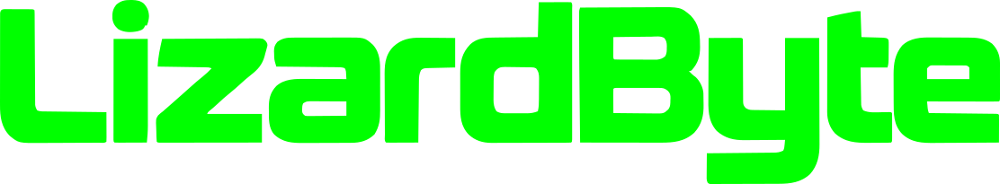
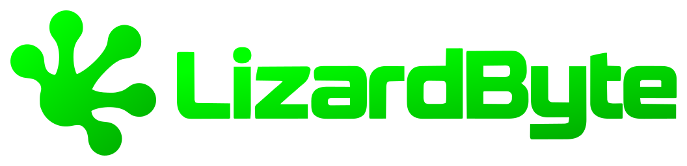
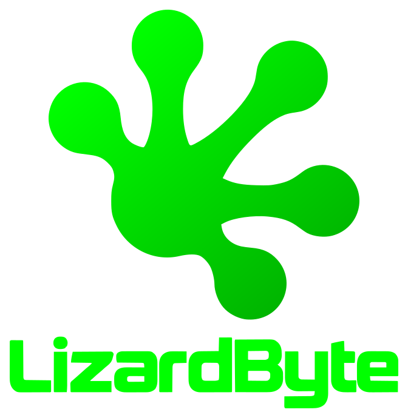

# LizardByte logos and wordmark

All SVG assets have transparent backgrounds and scale without losing detail.

| Asset | File | Preview |
| --- | --- | --- |
| Logo | [logo.svg](logo.svg) |  |
| Wordmark | [wordmark.svg](wordmark.svg) |  |
| Logo with wordmark to the right | [logo-wordmark-horizontal.svg](logo-wordmark-horizontal.svg) |  |
| Logo with wordmark below | [logo-wordmark-vertical.svg](logo-wordmark-vertical.svg) |  |

The wordmark is outlined from the supplied LizardByte reference artwork and uses brand green (`#00ff00`).
Both combined layouts embed the original logo's vector path and green gradient from `logo.svg`.
The SVGs are self-contained: lettering uses paths, with no installed fonts, linked files, or embedded raster images.

See [attribution.md](attribution.md) for the original logo credit.
